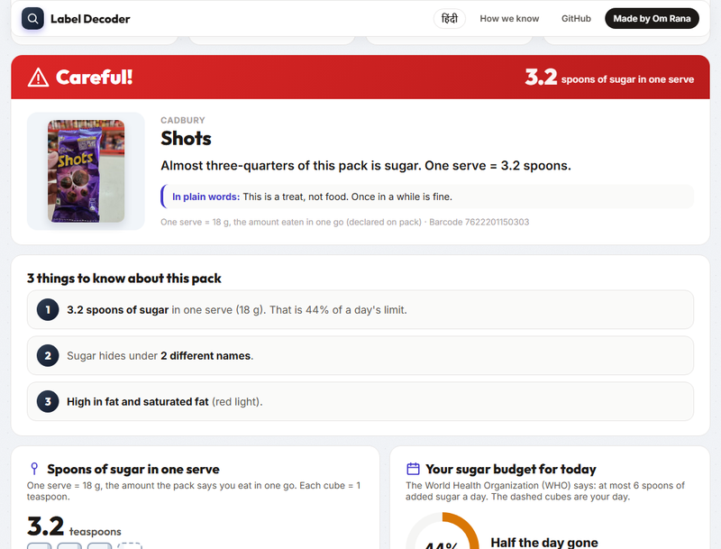
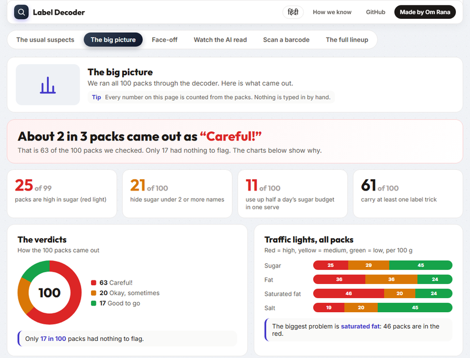

# Indian Label Decoder

**Live demo: https://labeldecoder-omrana.netlify.app** (opens instantly, 100 Indian packs decoded)

**It tells you whether a packaged food is healthy or not healthy, from the ingredient list and the nutrition
table on the back of the pack.** Four checks, each a green, yellow or red light, and one verdict.

Indian nutrition labels are legally correct and practically useless. "No added sugar" sits on a
pack sweetened with fruit concentrate. "High protein" is true per 100 g while the serve is 30 g.
Sugar is listed under three names so none of them tops the ingredient list.

Paste a label (photo or text) and get the real picture: **sugar per serve in teaspoons**, whether
each **front-of-pack claim survives per-serving maths**, which **ingredients are the same thing
under different names**, and which **FSSAI rule** the pack is technically following while
misleading you.





## How it works

```
photo / text ──> vision model (transcribes only) ──> structured label JSON
                                                          │
barcode ──> Open Food Facts ──────────────────────────────┤
                                                          ▼
                                             rules layer (pure Python, no model)
                                             ├─ sugar_aliases.py   60+ names for sugar, 3 tiers
                                             ├─ fssai_claims.py    Schedule I thresholds, Reg 4/5/6/8
                                             ├─ serving.py         per-100 ↔ per-serve, tsp, RDA, WHO
                                             ├─ decoder.py         26 mislead patterns, honest label
                                             └─ health.py          four health checks, one verdict
```

The model never judges. It transcribes the pack into JSON; every verdict comes from the rules
layer, so the same label always gives the same answer and every rule is unit-tested
(`pytest`, 39 tests). That split is what makes the accuracy numbers below meaningful: extraction
errors and rule errors are measured separately.

### What the rules layer knows

- **Sugar aliases** (`src/rules/sugar_aliases.py`): sucrose, jaggery/gur, liquid glucose, dextrose,
  invert syrup, malt extract, fruit juice concentrate, date paste, honey, condensed milk, choco
  chips ... in English, Hindi transliteration and INS numbers. Three tiers: added sugar,
  sugar-like (maltodextrin, maida), sweetener (sucralose, polyols). Whole fruit and milk are
  never flagged as added.
- **Consolidated rank**: with declared percentages the combined sugar rank is exact; without
  them it uses the only legal fact available (descending order of weight) and says so.
- **FSSAI Schedule I** (`src/rules/fssai_claims.py`): low/free thresholds for energy, fat,
  saturated fat, trans fat, cholesterol, sugar, sodium; source/high for protein (10%/20% RDA)
  and fibre (3/6 g). Each claim gets the legal test, the per-100 verdict and the per-serve
  reality side by side.
- **Mislead patterns** (`src/rules/decoder.py`): `SUGAR_SPLIT`, `NAS_SUBSTITUTE` (no added
  sugar + fruit concentrate), `NAS_HIGH_INTRINSIC`, `SUGAR_FREE_POLYOL`, `PER100_VS_SERVE`,
  `HALO_OVER_SUGAR`, `IMMUNITY_CLAIM`, `NATURAL_WITH_ADDITIVES`, `REAL_FRUIT_TRACE`,
  `MULTIGRAIN_MAIDA`, `BAKED_STILL_FATTY`, `CHOLESTEROL_FREE_PLANT`, `NO_MSG_GLUTAMATE`,
  `AS_PREPARED`, `SERVING_TINY`, `WHO_LIMIT_BLOWN`, `SODIUM_HIGH`, `TRANS_FAT` and eight more
  (26 in all). Each carries the regulation it leans on.

Thresholds follow the FSS (Advertising and Claims) Regulations 2018 and the FSS (Labelling and
Display) Regulations 2020 as published; amendments happen, so re-verify before quoting publicly.

## Is it healthy? Four checks, one verdict

Every pack (the 100 built in, a barcode, a photo, pasted text) gets four lights. Each is green, yellow or red.

| Check | What it looks at | Cut-off comes from |
|---|---|---|
| **Sugar** | Free sugar per 100 g and in one serve, and whether it is split across names | UK traffic-light criteria per 100 g; red on its own when one serve is 30% of WHO's 25 g a day |
| **Fat and salt** | Saturated fat, trans fat, salt | UK traffic-light criteria; 30% of a day in one serve (22 g saturated fat, 2000 mg sodium, FSSAI); trans fat above FSSAI's 0.2 g "trans fat free" line |
| **Ingredients** | Maida or sugar first, palm or hydrogenated fat, industrial substances, cosmetic additives | NOVA markers of ultra-processed food (Monteiro et al. 2019); ICMR-NIN 2024 on refined flour and palm oil |
| **Good stuff** | Protein and fibre | FSSAI Schedule I "source of" and "high in" |

The verdict has no weights. It only counts the lights:

- **Healthy**: no red, at most one yellow
- **Okay, sometimes**: one red, or two or more yellows
- **Not healthy**: two or more reds

Under it, one line says how far a serve goes: "3 serves = a full day's sugar".

Choices made on purpose, and their limits:

- The sugar light uses **free sugar** (added sugar, plus all the sugar in juice, honey and syrups), because that
  is what WHO limits. Milk sugar and the sugar inside whole fruit are not counted, so plain milk is green on sugar
  and raisins are too. The UK scheme itself uses total sugar.
- Ingredients: 0 markers is green, 1 or 2 is yellow, 3 or more is red. NOVA itself calls a food ultra-processed
  from one marker; the yellow band is ours. Preservatives, antioxidants, acidity regulators and raising agents are
  not counted.
- Nuts and cooking oils come out red on saturated fat per 100 g, like in every per-100 g scheme. Water and oils
  are not marked down for having no protein.
- Label tricks (a tiny serve, a claim that fails per serve) do not change the health verdict. They stay in their
  own section: "is the pack honest" is a different question from "is it healthy".
- It knows the pack, not the person. Not medical advice.

Serve-size fixes made with this (21 Nov): a drink with no usable serve now assumes a 200 ml glass instead of 30 g,
oils assume 10 g, a drink "serve" under 5 ml is treated as a typo, and two crowd-data rows with impossible salt
(a bottled water at 3 g per 100 ml, a soft drink at 25 g) had sodium blanked. Six of the 100 packs changed serve.

## Run it

```bash
pip install -r requirements.txt
streamlit run app.py          # the photo app
python build_static.py        # the website, written to site/
```

On Windows, double-click `RUN.bat`: 1 opens the website (`site/index.html`, the same file that is deployed), 2 starts the photo app.

Photo and text input need a model key: `ANTHROPIC_API_KEY` (Claude, default model
`claude-opus-5-5`, server-side refusal fallback on) or `GEMINI_API_KEY` (free tier,
`gemini-3.8-flash`). Barcode lookup and the 100 built-in packs work with no key.

No pack in hand? The photo tab has three real packs (`samples/`: Parle-G, Maggi, Cadbury Shots, photos from
Open Food Facts, CC BY-SA). One click sends the three photos to the model, shows what it read field by field
(step 1), then the verdict the rules made from it (step 2). A read takes about 5 to 10 seconds: reading
numbers off a pack needs no long reasoning, so the Gemini call asks for low thinking (25 s down to 8.5 s on
the same photos, identical numbers). A hosted copy reads the key from Streamlit "Secrets" and allows 10 AI
reads per visit, because it runs on a free-tier key.

Gemini needs one adjustment that Claude does not: asked to copy the ingredient list word for word, every Gemini model blocked its own answer (`finishReason: RECITATION`), so the Gemini path asks for the ingredients only as separate items, which is what the rules read anyway. It also walks a short list of models, because the newest one is often busy on the free tier.

Two deployments: the **Streamlit app** (photo, pasted text, any barcode; needs a key, sleeps when
idle) and a **static site** for instant loading. `python build_static.py` decodes all 100 packs
once with the same rules and the same HTML builders (`src/ui.py`), writes `site/`
(one `index.html` plus 100 share cards), and that folder goes to Netlify as is.

Every result opens with the verdict, **3 things to know** (sugar in spoons, the catch, fat and salt) and the spoons, then the full breakdown below in the same scroll. The plain-words lines are written in English and Hindi, and the static site has a switch for it.

The static site adds two things the numbers make possible. **The big picture** is a dashboard counted
from the 100 decoded packs (verdict split, traffic lights, the ten sweetest packs, the most common
tricks). **Watch the AI read** replays recorded photo readings from the accuracy test field by field
against the database, including one pack where the AI and the database disagree and the photo shows
the database is the one that is wrong.

## Evaluation

```bash
python eval/build_testset.py      # 100 Indian products from Open Food Facts: photos + structured data
python eval/run_eval.py           # rules layer always; extraction accuracy when a key is set
```

Two layers, scored separately (`eval/results/report.md`):

1. **Rules layer** on the 100-product set: determinism check (decode twice, diff), share of
   products with sugar under 2+ names, flag distribution, top-15 by sugar. No model needed.
2. **Extraction accuracy**: the vision model reads the pack photos; every numeric field is
   compared against the reference with tolerance max(0.5, 10%). Reference = hand-checked rows
   in `eval/manual_labels.csv` (preferred) else Open Food Facts rows that pass sanity checks
   (OFF is crowd-sourced and has decimal-point errors; `sanity()` catches the obvious ones).
   Accuracy is broken down by field, by the `condition` tag you set per photo (good, low light,
   glare, regional language, crumpled) and by image resolution, so "where it breaks" is a table.

Current run (`eval/results/report.md`, 2 Oct 2026, rules layer on 100 OFF India products):

| | |
|---|---|
| Decoded twice, outputs differed | 0 |
| Products with sugar under 2+ names | 21 of 100 |
| Flags raised | SAT_FAT_HIGH 26, SUGAR_SPLIT 21, WHO_LIMIT_HALF 8, SODIUM_HIGH 8, SERVING_TINY 4, TRANS_FAT 3, WHO_LIMIT_BLOWN 2 (recounted 21 Nov, see the serve-size note below) |
| Health verdict (four checks) | Not healthy 42, Okay sometimes 47, Healthy 11 |
| Liquid/solid fix (23 Oct) | Open Food Facts marked 56 of 100 packs "per 100 ml", including noodles, bread and oats. The decoder now treats a pack as liquid only when its name or category says drink, milk, juice, water or oil (16 left). SERVING_TINY fell from 19 to 7 as a result. |
| Extraction field accuracy (vision model vs Open Food Facts reference, 98 products, 8 numeric fields, tolerance max(0.5, 10%)) | **87.3%** |
| By the model's own legibility verdict | good 96.2% (49 products), partial 82.2%, poor 65.8% |
| Weakest fields | dietary fibre 65.3%, sodium 78.0% (salt/sodium conversions, "<1 g" bounds, cropped last rows) |
| Sugar alias recall (ingredient lists) | 91.0% |
| Serving size | 68.8% (packs that print only %RDA per serve, or a serve in ml for a powder) |

Provenance: the transcriptions were produced by Claude Sonnet subagents reading the 300 pack
photos (no API key on the machine; `src/extract.py` is the equivalent API path and `RUN-EVAL.bat`
re-runs it). The reference is Open Food Facts crowd data that passed `sanity()`; some of the
13% "errors" are OFF entry mistakes, which is what the hand-checked `manual_labels.csv` is for.
Where it breaks is now a table: crumpled or glary packs, per-serve-only US-style panels, curved
tubs and bottles, and ingredient strips in tiny type.

## Launch plan

Lead with findings, not the app: a "this health drink is X% sugar by weight, listed under
N names" post travels; "check out my app" does not. Targets: r/india, r/IndianFood,
r/nutrition, Twitter, Product Hunt. Track: users in 30 days, scans per user, D7 return.
The labelled test set, the accuracy numbers and the rules layer are in my control;
distribution is not.

## Layout

```
app.py                 Streamlit app (packs / barcode / photo / text / face-off); same look and motion as the website
samples/               three packs, three photos each, for the one-click live read
build_static.py        builds the static Netlify site from the same rules and UI code
src/ui.py              all HTML and CSS: verdict card, spoons, budget ring, traffic lights, share card
src/app_ui.py          Streamlit-only: restyles its widgets to the site design, runs the site's page script in the app
src/replays.py         the recorded photo readings for "Watch the AI read" (shared by app and site)
src/extract.py         vision transcription -> label JSON (schema-constrained)
src/llm.py             provider switch: Claude SDK or Gemini REST
src/off_api.py         Open Food Facts client + sanity checks
src/rules/             the food-science layer (see above)
eval/build_testset.py  pulls the OFF India test set with photos
eval/run_eval.py       two-layer evaluation, writes eval/results/
eval/manual_labels.csv hand-verified truth for the photos (fill in)
tests/test_rules.py    23 rule tests
tests/test_health.py   16 health-check tests
```
