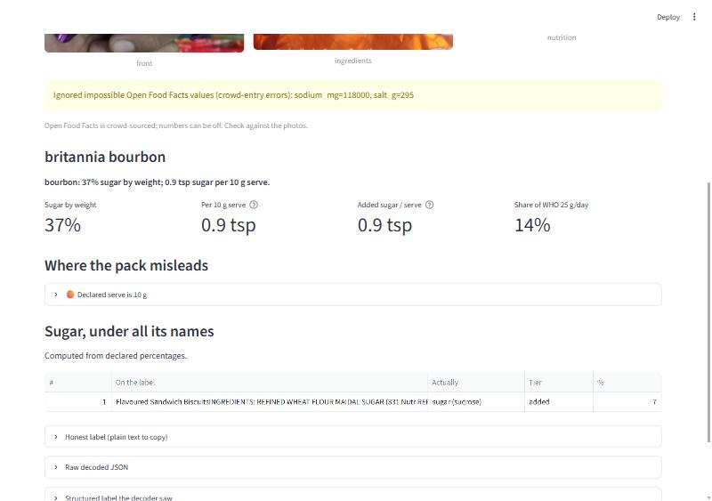

# Indian Label Decoder

Indian nutrition labels are legally correct and practically useless. "No added sugar" sits on a
pack sweetened with fruit concentrate. "High protein" is true per 100 g while the serve is 30 g.
Sugar is listed under three names so none of them tops the ingredient list.

Paste a label (photo or text) and get the real picture: **sugar per serve in teaspoons**, whether
each **front-of-pack claim survives per-serving maths**, which **ingredients are the same thing
under different names**, and which **FSSAI rule** the pack is technically following while
misleading you.



## How it works

```
photo / text ──> vision model (transcribes only) ──> structured label JSON
                                                          │
barcode ──> Open Food Facts ──────────────────────────────┤
                                                          ▼
                                             rules layer (pure Python, no model)
                                             ├─ sugar_aliases.py   60+ names for sugar, 3 tiers
                                             ├─ fssai_claims.py    Schedule I thresholds, Reg 4/5/6/8
                                             ├─ serving.py         per-100 ↔ per-serve, tsp, RDA, WHO
                                             └─ decoder.py         18 mislead patterns, honest label
```

The model never judges. It transcribes the pack into JSON; every verdict comes from the rules
layer, so the same label always gives the same answer and every rule is unit-tested
(`pytest`, 21 tests). That split is what makes the accuracy numbers below meaningful: extraction
errors and rule errors are measured separately.

### What the rules layer knows

- **Sugar aliases** (`src/rules/sugar_aliases.py`): sucrose, jaggery/gur, liquid glucose, dextrose,
  invert syrup, malt extract, fruit juice concentrate, date paste, honey, condensed milk, choco
  chips ... in English, Hindi transliteration and INS numbers. Three tiers: added sugar,
  sugar-like (maltodextrin, maida), sweetener (sucralose, polyols). Whole fruit and milk are
  never flagged as added.
- **Consolidated rank**: with declared percentages the combined sugar rank is exact; without
  them it uses the only legal fact available (descending order of weight) and says so.
- **FSSAI Schedule I** (`src/rules/fssai_claims.py`): low/free thresholds for energy, fat,
  saturated fat, trans fat, cholesterol, sugar, sodium; source/high for protein (10%/20% RDA)
  and fibre (3/6 g). Each claim gets the legal test, the per-100 verdict and the per-serve
  reality side by side.
- **Mislead patterns** (`src/rules/decoder.py`): `SUGAR_SPLIT`, `NAS_SUBSTITUTE` (no added
  sugar + fruit concentrate), `NAS_HIGH_INTRINSIC`, `SUGAR_FREE_POLYOL`, `PER100_VS_SERVE`,
  `HALO_OVER_SUGAR`, `IMMUNITY_CLAIM`, `NATURAL_WITH_ADDITIVES`, `REAL_FRUIT_TRACE`,
  `MULTIGRAIN_MAIDA`, `BAKED_STILL_FATTY`, `CHOLESTEROL_FREE_PLANT`, `NO_MSG_GLUTAMATE`,
  `AS_PREPARED`, `SERVING_TINY`, `WHO_LIMIT_BLOWN`, `SODIUM_HIGH`, `TRANS_FAT`. Each carries the
  regulation it leans on.

Thresholds follow the FSS (Advertising and Claims) Regulations 2018 and the FSS (Labelling and
Display) Regulations 2020 as published; amendments happen, so re-verify before quoting publicly.

## Run it

```bash
pip install -r requirements.txt
streamlit run app.py          # or double-click RUN.bat
```

Photo and text input need a model key: `ANTHROPIC_API_KEY` (Claude, default model
`claude-opus-5-5`, server-side refusal fallback on) or `GEMINI_API_KEY` (free tier,
`gemini-2.5-flash`). Barcode lookup and the Examples tab work with no key.

## Evaluation

```bash
python eval/build_testset.py      # 100 Indian products from Open Food Facts: photos + structured data
python eval/run_eval.py           # rules layer always; extraction accuracy when a key is set
```

Two layers, scored separately (`eval/results/report.md`):

1. **Rules layer** on the 100-product set: determinism check (decode twice, diff), share of
   products with sugar under 2+ names, flag distribution, top-15 by sugar. No model needed.
2. **Extraction accuracy**: the vision model reads the pack photos; every numeric field is
   compared against the reference with tolerance max(0.5, 10%). Reference = hand-checked rows
   in `eval/manual_labels.csv` (preferred) else Open Food Facts rows that pass sanity checks
   (OFF is crowd-sourced and has decimal-point errors; `sanity()` catches the obvious ones).
   Accuracy is broken down by field, by the `condition` tag you set per photo (good, low light,
   glare, regional language, crumpled) and by image resolution, so "where it breaks" is a table.

Current run (`eval/results/report.md`, 2 Oct 2026, rules layer on 100 OFF India products):

| | |
|---|---|
| Decoded twice, outputs differed | 0 |
| Products with sugar under 2+ names | 21 of 100 |
| Flags raised | SAT_FAT_HIGH 26, SUGAR_SPLIT 21, SODIUM_HIGH 10, SERVING_TINY 7, WHO_LIMIT_HALF 6, TRANS_FAT 3, WHO_LIMIT_BLOWN 2 |
| Liquid/solid fix (23 Oct) | Open Food Facts marked 56 of 100 packs "per 100 ml", including noodles, bread and oats. The decoder now treats a pack as liquid only when its name or category says drink, milk, juice, water or oil (16 left). SERVING_TINY fell from 19 to 7 as a result. |
| Extraction field accuracy (vision model vs Open Food Facts reference, 98 products, 8 numeric fields, tolerance max(0.5, 10%)) | **87.3%** |
| By the model's own legibility verdict | good 96.2% (49 products), partial 82.2%, poor 65.8% |
| Weakest fields | dietary fibre 65.3%, sodium 78.0% (salt/sodium conversions, "<1 g" bounds, cropped last rows) |
| Sugar alias recall (ingredient lists) | 91.0% |
| Serving size | 68.8% (packs that print only %RDA per serve, or a serve in ml for a powder) |

Provenance: the transcriptions were produced by Claude Sonnet subagents reading the 300 pack
photos (no API key on the machine; `src/extract.py` is the equivalent API path and `RUN-EVAL.bat`
re-runs it). The reference is Open Food Facts crowd data that passed `sanity()`; some of the
13% "errors" are OFF entry mistakes, which is what the hand-checked `manual_labels.csv` is for.
Where it breaks is now a table: crumpled or glary packs, per-serve-only US-style panels, curved
tubs and bottles, and ingredient strips in tiny type.

## Launch plan

Lead with findings, not the app: a "this health drink is X% sugar by weight, listed under
N names" post travels; "check out my app" does not. Targets: r/india, r/IndianFood,
r/nutrition, Twitter, Product Hunt. Track: users in 30 days, scans per user, D7 return.
The labelled test set, the accuracy numbers and the rules layer are in my control;
distribution is not.

## Layout

```
app.py                 Streamlit UI (photo / text / barcode / examples)
src/extract.py         vision transcription -> label JSON (schema-constrained)
src/llm.py             provider switch: Claude SDK or Gemini REST
src/off_api.py         Open Food Facts client + sanity checks
src/rules/             the food-science layer (see above)
eval/build_testset.py  pulls the OFF India test set with photos
eval/run_eval.py       two-layer evaluation, writes eval/results/
eval/manual_labels.csv hand-verified truth for the photos (fill in)
tests/test_rules.py    21 rule tests
```
